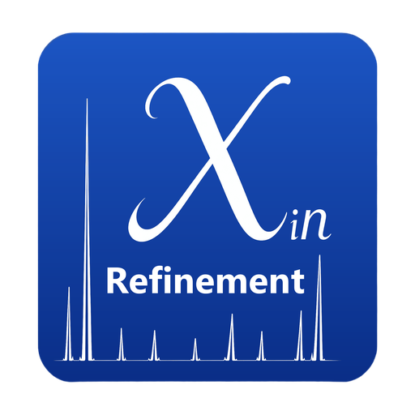

# XinRefinement

  

**通用粉末衍射全谱拟合桌面软件 —— Rietveld 结构精修 / Le Bail / 谱图精修。**

简体中文 · [English](README.md)

## 当前版本：v1.6.4

| | |
|---|---|
| **下载** | [`XinRefinement-1.6.4-setup.exe`](https://github.com/XinProf/XinRefinement/releases/tag/v1.6.4) —— Windows x64，中/英/日 三语安装界面 |
| **发布说明** | [v1.6.4 — 审计整改第三批](https://github.com/XinProf/XinRefinement/releases/tag/v1.6.4) |
| **变更记录** | [CHANGELOG.md](CHANGELOG.md) |
| **SHA256** | `258afa309558adfc18ca4a9bed3193213c2982b56006460291fae0a6f5b90701` |

## 能力概览

- **全谱拟合**：Rietveld 结构精修、Le Bail、纯谱图精修
- **定量**：物相含量与不确定度；文本 / JSON / HTML 报告
- **峰形与微结构**：EWIMV 织构、Popa LB 各向异性尺寸/应变、Brindley 微吸收、TCH 峰形、晶胞与原子坐标（xyz）精修
- **三个入口**：Qt6 图形界面、命令行、Python 库 API
- **家族互通**：导入 XinMatch 物相分析（`.xinm`），工程文件 `.xinr` 自包含

## 文档

- [评估报告 —— 7 个实样与 MAUD 对拍](docs/评估报告-实样对拍-MAUD-v1.md)
- [改进计划与验收标准](docs/立项-MAUD对标改进计划-v1.md)
- [审计整改后续计划](docs/后续计划-审计整改-backlog.md)
- [历史发布说明](docs/)

## 许可

[LICENSE](LICENSE) · [LICENSE-CN](LICENSE-CN)
